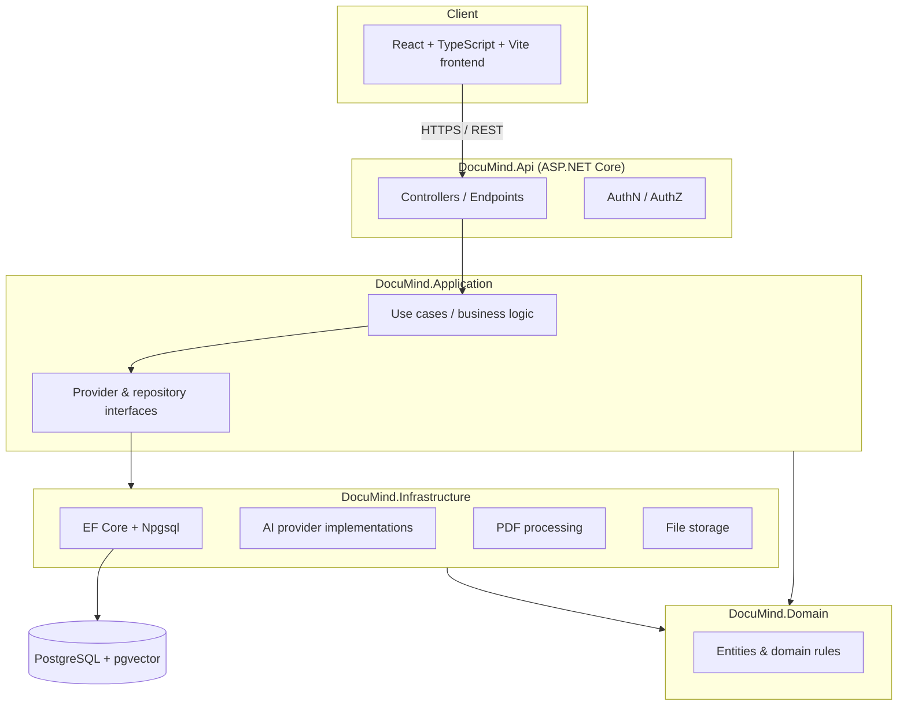

# DocuMind AI

Intelligent document search and AI knowledge assistant. Upload PDFs, search them with natural
language, and get grounded, citation-backed answers — never invented page numbers or quotes.

> **Status: Milestone 2 of 8 — Authentication & document library.** This is an actively developed
> portfolio project. See [Project status](#project-status) for exactly what is implemented and
> verified today versus what is planned. Do not assume any feature exists beyond what's listed there.

## Problem statement

Students, researchers, and professionals routinely need to find specific facts buried in long
PDFs — handbooks, papers, policies, regulations — and then verify that what they found is actually
in the source document. Generic chatbots can answer confidently and still be wrong. DocuMind AI is
built around the opposite priority: every factual answer must be grounded in retrieved passages
from the user's own documents, with a real citation (document + page) the user can click to verify.
If the documents don't contain a reliable answer, the system says so instead of guessing.

## Main features (target scope)

- Multi-document PDF upload with page-level text extraction and processing status tracking.
- Semantic (vector) search over document chunks via PostgreSQL + pgvector, with optional keyword/hybrid search.
- Retrieval-augmented question answering with validated, clickable source citations.
- Document summarization (short, detailed, key points, section-by-section).
- Conversation history scoped to one user, one or more documents.
- Secure authentication, strict per-user document/conversation ownership on every request.
- Works in a development mode with a mock AI/embedding provider when no paid API key is configured.

## Architecture



Layer responsibilities follow a standard clean/layered architecture: **Domain** holds entities and
rules with no external dependencies; **Application** holds use cases and interfaces for everything
external (AI providers, storage, PDF extraction); **Infrastructure** implements those interfaces
against PostgreSQL, pgvector, and AI providers; **Api** exposes HTTP endpoints and wires everything
together via dependency injection.

## Technology stack

**Backend:** C#, ASP.NET Core Web API (.NET 10), Entity Framework Core 10, Npgsql, Serilog, Swashbuckle (OpenAPI/Swagger).
**Frontend:** React 19, TypeScript, Vite, Tailwind CSS v4, React Router, Axios.
**Database:** PostgreSQL 16 with the pgvector extension.
**Dev/Ops:** Docker Compose, GitHub Actions (planned), xUnit.

## Project status

### Implemented and verified (Milestone 1 — Foundation)

- Solution structure: `DocuMind.Domain`, `DocuMind.Application`, `DocuMind.Infrastructure`,
  `DocuMind.Api`, `DocuMind.Tests`, `DocuMind.IntegrationTests`, wired together with project
  references in [DocuMind.sln](DocuMind.sln).
- `AppDbContext` configured for PostgreSQL via Npgsql, with the `vector` extension registered
  ([src/DocuMind.Infrastructure/Persistence/AppDbContext.cs](src/DocuMind.Infrastructure/Persistence/AppDbContext.cs)).
  No entities yet — those arrive with the document library and RAG milestones.
- Health checks at `/health/live` (process liveness) and `/health/ready` (verifies a real
  PostgreSQL connection via `AspNetCore.HealthChecks.NpgSql`) — confirmed healthy against a live
  Dockerized Postgres instance.
- Swagger UI at `/swagger` via Swashbuckle, serving a real generated OpenAPI document — confirmed
  reachable with a running API.
- Serilog structured console logging, with request logging middleware.
- CORS configured for the local Vite dev origin (`http://localhost:5173`).
- React + TypeScript + Vite frontend with Tailwind CSS v4, React Router, and a reusable
  `Button` component. Landing page implemented per spec (hero, 3-step explainer, feature grid,
  illustrative example Q&A clearly labeled as illustrative, privacy messaging, footer) and a
  genuine 404 page for unmatched routes. Both verified by actually running the Vite dev server and
  screenshotting the rendered output — see [docs/screenshots/landing-page.png](docs/screenshots/landing-page.png).
- Docker Compose brings up PostgreSQL 16 with pgvector, backed by a named volume
  (`documind-postgres-data`) — confirmed the `vector` extension creates successfully.
- Git repository initialized; `.gitignore` covers .NET, Node, and IDE artifacts plus local upload
  storage; `.env.example` documents every configuration key without committing real secrets;
  local database connection string for `dotnet run` is stored via `dotnet user-secrets`, not in
  any committed file.

### Implemented and verified (Milestone 2 — Authentication & document library)

- **Authentication** via ASP.NET Core Identity with secure HTTP-only, SameSite=Lax cookies
  (`options.Cookie` config in [Program.cs](src/DocuMind.Api/Program.cs)) — `POST /api/auth/register`,
  `POST /api/auth/login`, `POST /api/auth/logout`, `GET /api/auth/me`. Account lockout after 5
  failed attempts (brute-force protection), rate limiting (10 requests/minute) on both endpoints.
  Verified with 10 real integration tests against a live Postgres database (register → cookie
  issued → `/me` returns the right profile; wrong password rejected generically; logout actually
  clears the session) in [AuthApiTests.cs](src/DocuMind.IntegrationTests/AuthApiTests.cs).
- **Lightweight CSRF defense**: state-changing requests must carry an `X-Requested-With` header —
  verified by a real test asserting the request is rejected without it
  ([CsrfProtectionMiddleware.cs](src/DocuMind.Api/Middleware/CsrfProtectionMiddleware.cs)).
- **Document upload & validation pipeline**: file-name/extension/size checks, a real PDF magic-number
  signature check, and an actual parse via PdfPig (page count, encrypted-PDF detection) before
  anything is persisted — never trusts the browser-supplied content type
  ([DocumentUploadValidator.cs](src/DocuMind.Application/Documents/DocumentUploadValidator.cs),
  [DocumentService.cs](src/DocuMind.Application/Documents/DocumentService.cs)).
- **Private local file storage**: uploaded files are saved under a server-generated GUID name
  (never the user-supplied filename) in a non-web-accessible directory, with a path-escape guard
  ([LocalFileStorage.cs](src/DocuMind.Infrastructure/Storage/LocalFileStorage.cs)).
- **Document library API**: `POST /api/documents` (upload), `GET /api/documents` (paginated,
  searchable by filename, filterable by status, sortable), `GET /api/documents/{id}`,
  `GET /api/documents/{id}/status`, `DELETE /api/documents/{id}` — every query is filtered by the
  authenticated user's ID at the database level, so one user can never see, list, or delete
  another user's documents. Verified with real integration tests covering the full
  upload→list→get→delete lifecycle *and* explicit cross-user isolation
  ([DocumentsApiTests.cs](src/DocuMind.IntegrationTests/DocumentsApiTests.cs)).
- **EF Core migrations** applied to the live Postgres container: Identity tables plus `Documents`
  — confirmed via `\dt` against the running database.
- **Document library frontend**: registration and login pages, an `AuthContext` driving protected
  routes (unauthenticated visits to `/documents` redirect to `/login`), drag-and-drop or
  click-to-browse PDF upload, a sortable/filterable/searchable document table with real status
  badges, and a delete confirmation dialog. All driven end-to-end in a real headless Chrome
  session (register → upload a real PDF → see it listed with correct metadata → delete → empty
  state → logout → confirm the protected route redirects) — see
  [docs/screenshots/document-library.png](docs/screenshots/document-library.png).
- **Supply-chain catch**: the NuGet package ID `UglyToad.PdfPig` (the name used in the project's
  own public documentation) turned out to be squatted — owned by an unrelated account, unlicensed,
  with a fabricated `-custom` version tag. Verified this before installing anything and used the
  real package, plain `PdfPig` (owners EliotJones/BobLd, Apache-2.0, backing the genuine
  `UglyToad/PdfPig` GitHub repo), instead.

### Not yet implemented (planned, later milestones)

Text extraction/chunking, embeddings, semantic/keyword search, RAG chat, summaries, conversation
persistence, the dashboard/chat/settings pages, retry-failed-processing, and the full Docker
Compose stack (API + frontend containers) all come in Milestones 3–8. Nothing above this line
should be assumed to exist.

## Prerequisites

- [.NET SDK 10](https://dotnet.microsoft.com/download) (developed against 10.0.301)
- [Node.js](https://nodejs.org/) 20+ (developed against 24.20.0 LTS) and npm
- [Docker Desktop](https://www.docker.com/products/docker-desktop/) (for PostgreSQL + pgvector)
- Git

## Getting started

### 1. Start PostgreSQL (with pgvector)

```powershell
docker compose up -d postgres
```

This starts PostgreSQL 16 with the pgvector extension available, on `localhost:5432`, using the
credentials in `docker-compose.yml` (override via a `.env` file copied from `.env.example`).

### 2. Configure the backend's database connection

The committed `appsettings.json` only contains a placeholder connection string. For local
development, set the real one via user secrets (never commit real credentials):

```powershell
cd src/DocuMind.Api
dotnet user-secrets set "ConnectionStrings:Postgres" "Host=localhost;Port=5432;Database=documind;Username=documind;Password=documind_dev_local_only"
```

### 3. Apply database migrations

```powershell
dotnet tool install --global dotnet-ef   # once
dotnet-ef database update --project src/DocuMind.Infrastructure --startup-project src/DocuMind.Api
```

### 4. Run the backend

```powershell
dotnet build
dotnet run --project src/DocuMind.Api
```

- Swagger UI: http://localhost:5180/swagger
- Liveness: http://localhost:5180/health/live
- Readiness (checks the database): http://localhost:5180/health/ready

### 5. Run the frontend

```powershell
cd frontend
npm install
npm run dev
```

Open http://localhost:5173. The Vite dev server proxies `/api/*` requests to the backend at
`http://localhost:5180`.

## Environment configuration

See [.env.example](.env.example) for every configuration key (database, AI provider, embedding
provider, upload limits, storage directory). Copy it to `.env` for Docker Compose, and use
`dotnet user-secrets` for the backend's local connection string rather than putting secrets in
`appsettings.json`.

## Running tests

```powershell
dotnet test
```

`DocuMind.Tests` has 22 unit tests (file-validation rules, PDF signature checks, paged-result math,
claims parsing) — no I/O, run in well under a second. `DocuMind.IntegrationTests` has 10 tests that
spin up the real API in-process (`WebApplicationFactory`) against a dedicated `documind_test`
database on the same local Postgres container, covering register/login/logout, the full document
upload→list→get→delete lifecycle, cross-user isolation, CSRF rejection, and invalid-PDF rejection.
The `documind_test` database must exist first — see
[Troubleshooting](#troubleshooting) if `dotnet test` fails with a connection error.

## Database and pgvector setup

`docker compose up -d postgres` brings up PostgreSQL 16 with pgvector using the
`pgvector/pgvector:pg16` image. `AppDbContext.OnModelCreating` registers the `vector` extension.
EF Core migrations currently create the ASP.NET Core Identity tables and `Documents`; `DocumentChunk`
and its pgvector column arrive in Milestone 4 once semantic search is implemented.

## Security and privacy considerations

- No secrets are committed to the repository; `ConnectionStrings:Postgres` is stored via
  `dotnet user-secrets` locally and must come from environment variables in any deployed
  environment.
- Passwords are hashed by ASP.NET Core Identity (PBKDF2) — never stored or logged in plain text.
- Auth cookies are `HttpOnly`, `SameSite=Lax`, and `Secure` outside local development.
- A custom `X-Requested-With` header is required on every state-changing request as CSRF defense
  for cookie-based auth (see [docs/security.md](docs/security.md) for the reasoning and trade-offs).
- Login is rate-limited (10/minute) and accounts lock out for 5 minutes after 5 failed attempts.
- Every document query (`list`, `get`, `delete`) filters by the authenticated user's ID in the
  database query itself — not an after-the-fact check — and is covered by an integration test that
  asserts a second user gets a 404, not a 403, for another user's document (so the API never
  confirms *that* a given ID exists for someone else).
- Uploads are validated by PDF file signature and an actual PdfPig parse, not the browser-supplied
  `Content-Type`; stored files use a server-generated name, never the original filename.
- CORS is restricted to an explicit allow-list of origins (configured in `appsettings.json`).
- Health check responses do not expose connection strings, stack traces, or other internal detail.
- Prompt-injection mitigations for AI-generated answers arrive with the RAG milestone and will be
  documented in [docs/security.md](docs/security.md) at that point.

## Known limitations

This is Milestone 2 of 8. There is no text extraction, no embeddings, no search, and no AI
integration yet — documents are stored and validated but not indexed. Logout relies on the client
discarding the cookie it's told to discard (standard for stateless cookie auth); there is no
server-side session revocation list. Treat this repository as a verified foundation with real
auth and document management, not a complete product yet.

## Roadmap

See the milestone list in [docs/architecture.md](docs/architecture.md) for the full plan:
authentication & document library → PDF extraction/indexing → semantic search → RAG question
answering → summaries & source viewer → security hardening → deployment & portfolio readiness.

## Troubleshooting

- **`/health/ready` returns unhealthy / API fails to start with a connection error** — confirm
  `docker compose ps` shows `documind-postgres` as `healthy`, and that the user-secret connection
  string matches the credentials in `docker-compose.yml`.
- **`dotnet test` fails to connect for `DocuMind.IntegrationTests`** — the tests target a separate
  `documind_test` database on the same Postgres container. Create it once:
  `docker exec documind-postgres psql -U documind -d documind -c "CREATE DATABASE documind_test;"`.
  Migrations apply automatically when the tests run.
- **Frontend can't reach the API** — confirm the backend is running on port 5180 and that
  `frontend/vite.config.ts`'s proxy target matches.
- **Docker commands fail with a pipe/engine error** — Docker Desktop isn't running; start it and
  wait for the engine to report ready (`docker info`) before retrying.

## License and attribution

License to be finalized before the project is made public. Third-party dependencies are listed in
[DocuMind.sln](DocuMind.sln)'s project files (`*.csproj`) and [frontend/package.json](frontend/package.json).
