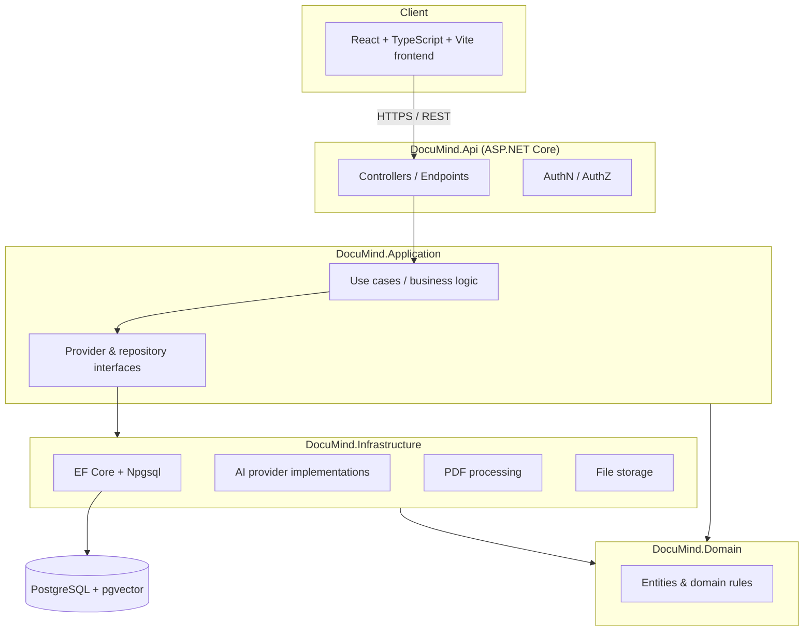
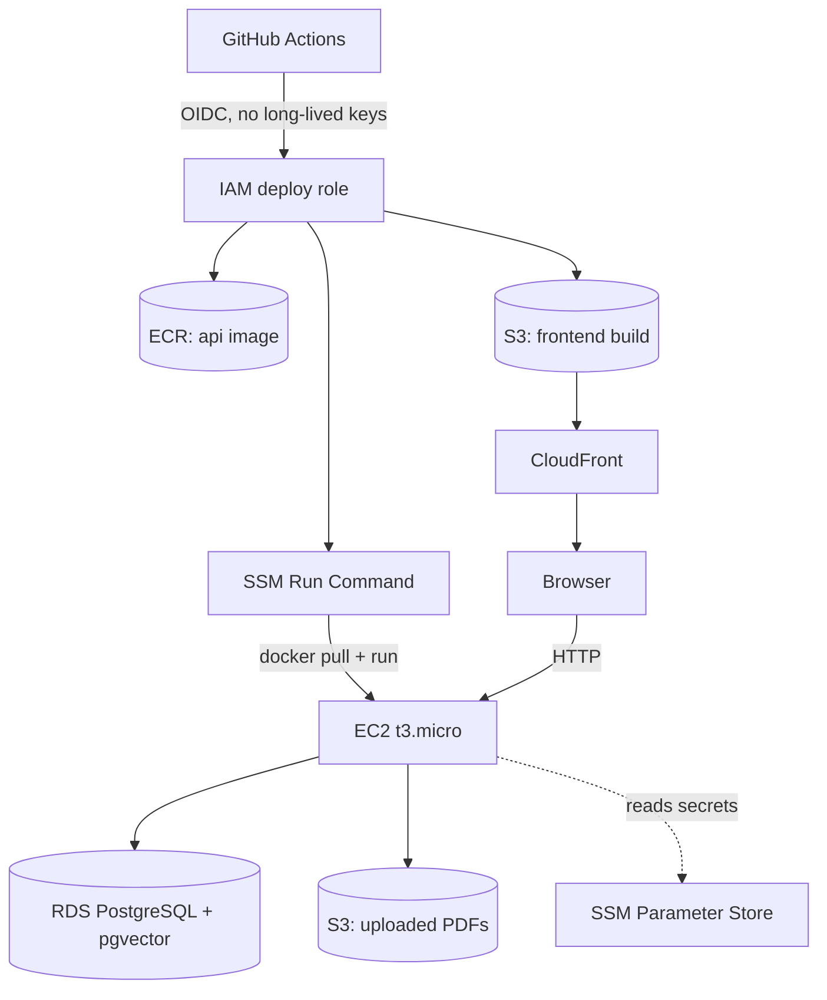

# DocuMind AI

Intelligent document search and AI knowledge assistant. Upload PDFs, search them with natural
language, and get grounded, citation-backed answers — never invented page numbers or quotes.

> **Status: Milestone 8 of 8 — Deployment & portfolio readiness. All 8 planned milestones are
> complete.** See [Project status](#project-status) for exactly what is implemented and verified
> — and [Known limitations](#known-limitations) for the honest, permanent gaps (OCR, section-by-
> section summaries) that remain by design rather than oversight. Do not assume any feature exists
> beyond what's listed there.

## Problem statement

Students, researchers, and professionals routinely need to find specific facts buried in long
PDFs — handbooks, papers, policies, regulations — and then verify that what they found is actually
in the source document. Generic chatbots can answer confidently and still be wrong. DocuMind AI is
built around the opposite priority: every factual answer must be grounded in retrieved passages
from the user's own documents, with a real citation (document + page) the user can click to verify.
If the documents don't contain a reliable answer, the system says so instead of guessing.

## Main features (target scope)

- Multi-document PDF upload with page-level text extraction and processing status tracking.
- Semantic (vector) search over document chunks via PostgreSQL + pgvector, with optional keyword/hybrid search.
- Retrieval-augmented question answering with validated, clickable source citations.
- Document summarization (short, detailed, key points, section-by-section).
- Conversation history scoped to one user, one or more documents.
- Secure authentication, strict per-user document/conversation ownership on every request.
- Works in a development mode with a mock AI/embedding provider when no paid API key is configured.

## Architecture



Layer responsibilities follow a standard clean/layered architecture: **Domain** holds entities and
rules with no external dependencies; **Application** holds use cases and interfaces for everything
external (AI providers, storage, PDF extraction); **Infrastructure** implements those interfaces
against PostgreSQL, pgvector, and AI providers; **Api** exposes HTTP endpoints and wires everything
together via dependency injection.

## Technology stack

**Backend:** C#, ASP.NET Core Web API (.NET 10), Entity Framework Core 10, Npgsql, Serilog, Swashbuckle (OpenAPI/Swagger).
**Frontend:** React 19, TypeScript, Vite, Tailwind CSS v4, React Router, Axios.
**Database:** PostgreSQL 16 with the pgvector extension.
**Dev/Ops:** Docker Compose (full stack: Postgres + API + frontend, each with its own
Dockerfile), GitHub Actions CI (backend build/test against a real Postgres service container,
frontend build), xUnit.

## Project status

### Implemented and verified (Milestone 1 — Foundation)

- Solution structure: `DocuMind.Domain`, `DocuMind.Application`, `DocuMind.Infrastructure`,
  `DocuMind.Api`, `DocuMind.Tests`, `DocuMind.IntegrationTests`, wired together with project
  references in [DocuMind.sln](DocuMind.sln).
- `AppDbContext` configured for PostgreSQL via Npgsql, with the `vector` extension registered
  ([src/DocuMind.Infrastructure/Persistence/AppDbContext.cs](src/DocuMind.Infrastructure/Persistence/AppDbContext.cs)).
  No entities yet — those arrive with the document library and RAG milestones.
- Health checks at `/health/live` (process liveness) and `/health/ready` (verifies a real
  PostgreSQL connection via `AspNetCore.HealthChecks.NpgSql`) — confirmed healthy against a live
  Dockerized Postgres instance.
- Swagger UI at `/swagger` via Swashbuckle, serving a real generated OpenAPI document — confirmed
  reachable with a running API.
- Serilog structured console logging, with request logging middleware.
- CORS configured for the local Vite dev origin (`http://localhost:5173`).
- React + TypeScript + Vite frontend with Tailwind CSS v4, React Router, and a reusable
  `Button` component. Landing page implemented per spec (hero, 3-step explainer, feature grid,
  illustrative example Q&A clearly labeled as illustrative, privacy messaging, footer) and a
  genuine 404 page for unmatched routes. Both verified by actually running the Vite dev server and
  screenshotting the rendered output — see [docs/screenshots/landing-page.png](docs/screenshots/landing-page.png).
- Docker Compose brings up PostgreSQL 16 with pgvector, backed by a named volume
  (`documind-postgres-data`) — confirmed the `vector` extension creates successfully.
- Git repository initialized; `.gitignore` covers .NET, Node, and IDE artifacts plus local upload
  storage; `.env.example` documents every configuration key without committing real secrets;
  local database connection string for `dotnet run` is stored via `dotnet user-secrets`, not in
  any committed file.

### Implemented and verified (Milestone 2 — Authentication & document library)

- **Authentication** via ASP.NET Core Identity with secure HTTP-only, SameSite=Lax cookies
  (`options.Cookie` config in [Program.cs](src/DocuMind.Api/Program.cs)) — `POST /api/auth/register`,
  `POST /api/auth/login`, `POST /api/auth/logout`, `GET /api/auth/me`. Account lockout after 5
  failed attempts (brute-force protection), rate limiting (10 requests/minute) on both endpoints.
  Verified with 10 real integration tests against a live Postgres database (register → cookie
  issued → `/me` returns the right profile; wrong password rejected generically; logout actually
  clears the session) in [AuthApiTests.cs](src/DocuMind.IntegrationTests/AuthApiTests.cs).
- **Lightweight CSRF defense**: state-changing requests must carry an `X-Requested-With` header —
  verified by a real test asserting the request is rejected without it
  ([CsrfProtectionMiddleware.cs](src/DocuMind.Api/Middleware/CsrfProtectionMiddleware.cs)).
- **Document upload & validation pipeline**: file-name/extension/size checks, a real PDF magic-number
  signature check, and an actual parse via PdfPig (page count, encrypted-PDF detection) before
  anything is persisted — never trusts the browser-supplied content type
  ([DocumentUploadValidator.cs](src/DocuMind.Application/Documents/DocumentUploadValidator.cs),
  [DocumentService.cs](src/DocuMind.Application/Documents/DocumentService.cs)).
- **Private local file storage**: uploaded files are saved under a server-generated GUID name
  (never the user-supplied filename) in a non-web-accessible directory, with a path-escape guard
  ([LocalFileStorage.cs](src/DocuMind.Infrastructure/Storage/LocalFileStorage.cs)).
- **Document library API**: `POST /api/documents` (upload), `GET /api/documents` (paginated,
  searchable by filename, filterable by status, sortable), `GET /api/documents/{id}`,
  `GET /api/documents/{id}/status`, `DELETE /api/documents/{id}` — every query is filtered by the
  authenticated user's ID at the database level, so one user can never see, list, or delete
  another user's documents. Verified with real integration tests covering the full
  upload→list→get→delete lifecycle *and* explicit cross-user isolation
  ([DocumentsApiTests.cs](src/DocuMind.IntegrationTests/DocumentsApiTests.cs)).
- **EF Core migrations** applied to the live Postgres container: Identity tables plus `Documents`
  — confirmed via `\dt` against the running database.
- **Document library frontend**: registration and login pages, an `AuthContext` driving protected
  routes (unauthenticated visits to `/documents` redirect to `/login`), drag-and-drop or
  click-to-browse PDF upload, a sortable/filterable/searchable document table with real status
  badges, and a delete confirmation dialog. All driven end-to-end in a real headless Chrome
  session (register → upload a real PDF → see it listed with correct metadata → delete → empty
  state → logout → confirm the protected route redirects) — see
  [docs/screenshots/document-library.png](docs/screenshots/document-library.png).
- **Supply-chain catch**: the NuGet package ID `UglyToad.PdfPig` (the name used in the project's
  own public documentation) turned out to be squatted — owned by an unrelated account, unlicensed,
  with a fabricated `-custom` version tag. Verified this before installing anything and used the
  real package, plain `PdfPig` (owners EliotJones/BobLd, Apache-2.0, backing the genuine
  `UglyToad/PdfPig` GitHub repo), instead.

### Implemented and verified (Milestone 3 — PDF extraction, chunking & background indexing)

- **Real page-by-page text extraction** via PdfPig, run by the background pipeline rather than at
  upload time (upload only validates the file; extraction is deferred so uploads stay fast)
  ([PdfPigTextExtractor.cs](src/DocuMind.Infrastructure/Documents/PdfPigTextExtractor.cs)).
- **Sentence-aware chunking** with configurable size/overlap: chunks never split a sentence
  mid-way (a single sentence longer than the chunk size is hard-split by length so nothing grows
  unbounded), trailing sentences carry into the next chunk as configurable overlap, and a chunk's
  page range is the min/max page of the sentences it actually contains — so a chunk spanning a
  page boundary still cites correctly
  ([TextChunker.cs](src/DocuMind.Application/Documents/TextChunker.cs)). Verified by 11 unit
  tests covering exactly these properties (never mid-sentence, correct page spans, overlap
  carried, zero-overlap means zero, blank pages skipped, oversized sentences hard-split).
- **Database-backed background worker** (`BackgroundService`, bounded concurrency, configurable
  poll interval): claims `Queued` documents, flips them to `Processing` (visible to the user
  immediately, not just at the end), extracts, chunks, persists, and marks `Indexed` or `Failed`
  ([DocumentIndexingBackgroundService.cs](src/DocuMind.Infrastructure/BackgroundJobs/DocumentIndexingBackgroundService.cs)).
- **Scanned/image-only PDFs are never silently "indexed" with nothing in them** — zero extractable
  text across every page is detected and the document is marked `Failed` with an explicit message
  that OCR isn't implemented yet, rather than reporting success with zero chunks.
- **Retry**: `POST /api/documents/{id}/retry` re-queues a `Failed` document (400 if it isn't
  currently failed); `GET /api/documents/{id}/chunks` returns the persisted chunks with page
  ranges, ownership-filtered like every other document endpoint.
- Verified end to end against the real pipeline (not mocked) with 5 new integration tests: a real
  3-page PDF is uploaded, polled through `Queued`→`Processing`→`Indexed`, and its chunks' page
  numbers are asserted against the actual source pages; a blank PDF is confirmed to fail with the
  OCR message and is proven to actually get reprocessed (not a no-op) on retry; chunks are proven
  invisible to a second user
  ([DocumentIndexingTests.cs](src/DocuMind.IntegrationTests/DocumentIndexingTests.cs)).
- **Frontend**: the document library now polls while anything is `Queued`/`Processing` so status
  updates appear without a manual refresh, and shows a **Retry** action on failed rows. Driven
  live in headless Chrome against the real running stack — a real multi-page PDF goes from
  `Queued` to `Indexed` with the correct page count, and a blank PDF fails with the OCR message,
  gets retried, and visibly fails again (proving retry really reprocesses it) — see
  [docs/screenshots/document-processing-states.png](docs/screenshots/document-processing-states.png).
- EF Core migration applied to the live Postgres container: `DocumentChunks` table, with a unique
  `(DocumentId, ChunkIndex)` index and cascade delete from `Documents`.

### Implemented and verified (Milestone 4 — Embeddings & semantic search)

- **Configurable embedding provider abstraction**: `Embedding:Provider` switches between `Mock`
  (default — a deterministic hashed-bag-of-words vector, zero external calls, no API key) and
  `OpenAI` (a real implementation with timeout, retry-with-backoff on 429/5xx, and usage logging
  that never logs document text or the API key) — selected at DI registration time
  ([MockEmbeddingProvider.cs](src/DocuMind.Infrastructure/Embeddings/MockEmbeddingProvider.cs),
  [OpenAiEmbeddingProvider.cs](src/DocuMind.Infrastructure/Embeddings/OpenAiEmbeddingProvider.cs)).
  The mock isn't just a stub: 6 unit tests confirm it's deterministic, dimension-correct, L2-normalized,
  and — genuinely useful for testing retrieval — that two texts sharing vocabulary score more
  similar than two that don't.
- **Embeddings are generated and persisted per chunk** during background indexing, stored in a
  pgvector `vector` column alongside the model identifier that produced them
  ([DocumentIndexer.cs](src/DocuMind.Application/Documents/DocumentIndexer.cs)). The column is
  deliberately dimension-less (not `vector(1536)`) so switching embedding models/providers never
  needs a schema migration — the trade-off, documented in
  [docs/architecture.md](docs/architecture.md), is that existing documents must be re-indexed
  (via retry) after a provider change, since mixing dimensions in one similarity query would error.
- **Real pgvector cosine-similarity search** and **real Postgres full-text keyword search**
  (`ts_vector`/`plain_to_tsquery`/`ts_rank`), both scoped to the caller's own documents at the
  database level and optionally further scoped to specific document IDs
  ([DocumentChunkRepository.cs](src/DocuMind.Infrastructure/Persistence/DocumentChunkRepository.cs)).
  Hybrid mode combines both via Reciprocal Rank Fusion (rank position, not raw score, since a
  cosine similarity and a text-search rank aren't on comparable scales) — 5 unit tests cover the
  fusion logic directly.
- **A minimum-similarity threshold** means an unrelated query returns an empty result list rather
  than a weak, misleading top match — verified by an integration test with a deliberately
  nonsense query.
- **`POST /api/search`**: query, mode (`Semantic`/`Keyword`/`Hybrid`), optional document-ID scope,
  optional top-K — ownership-filtered like every other endpoint. Verified by 8 integration tests
  against the real pipeline: semantic search finds a page via shared vocabulary with correct page
  numbers, keyword search finds an exact phrase, hybrid combines both, document-scoping excludes
  other documents, and — checked explicitly — search never returns another user's chunks.
- **Search results frontend**: mode toggle, an optional document-scope picker, and results shown
  with the matching page range and matched terms highlighted — driven end-to-end in real headless
  Chrome against the real running stack (upload → index → search finds the right page → a nonsense
  query correctly shows no results → scoping to one document works) — see
  [docs/screenshots/search-results.png](docs/screenshots/search-results.png).
- **A real, impactful test-isolation bug found and fixed**: parallel `IClassFixture`-per-class
  WebApplicationFactory instances were each running their own background indexing worker against
  the *same* shared `documind_test` database while each had a *different* local storage
  directory — one worker could claim a document whose file lived in another instance's directory,
  fail with `FileNotFoundException`, and report a misleading generic error. Worse, diagnosing it
  surfaced a second, more serious issue: the test host's configuration overrides were silently
  losing to `dotnet user-secrets` (auto-loaded because `WebApplicationFactory` defaults to the
  `Development` environment), meaning integration tests had actually been running against the
  **real local development database** the whole time, not the intended isolated `documind_test`.
  Both are fixed — one shared factory via an xUnit collection fixture, and the test host now runs
  under a `Testing` environment with overrides applied via environment variables — and documented
  in full in [docs/security.md](docs/security.md). The real `documind` database was cleaned of the
  contaminating test data this caused.

### Implemented and verified (Milestone 5 — RAG question answering)

- **Configurable chat-completion provider abstraction**, mirroring the embedding provider from
  Milestone 4: `Llm:Provider` switches between `Mock` (default — a deterministic, no-API-key
  implementation) and `OpenAI` (a real chat-completions client with timeout, retry-with-backoff on
  429/5xx, and no document text or API key ever logged)
  ([MockLlmProvider.cs](src/DocuMind.Infrastructure/Llm/MockLlmProvider.cs),
  [OpenAiLlmProvider.cs](src/DocuMind.Infrastructure/Llm/OpenAiLlmProvider.cs)). The mock isn't a
  canned string: it picks, for each retrieved passage, the sentence that actually shares the most
  vocabulary with the question, and cites the passage it drew from — verified by 5 unit tests.
- **Retrieval reused, not reimplemented.** `ISearchService` gained `RetrieveAsync`, returning the
  same ownership-filtered, threshold-floored, RRF-fused ranking as `/api/search` but with full
  chunk text instead of a UI-sized excerpt — the RAG pipeline and the search endpoint now share one
  retrieval implementation rather than two that could drift apart
  ([SearchService.cs](src/DocuMind.Application/Search/SearchService.cs)).
- **Grounded answer generation with citation validation that doesn't trust the model.**
  `RagAnswerGenerator` retrieves context, and — only if something relevant was actually found —
  asks the LLM to answer using numbered `[n]` passage markers. Every `[n]` marker the model emits
  is checked against the context blocks that generator itself provided; a marker pointing at a
  passage number that was never offered (hallucinated or out of range) is silently dropped rather
  than resolved to the wrong source. If nothing relevant was retrieved, the LLM is never called at
  all and the user gets an explicit "I don't have enough information in your documents" answer —
  the same "say so instead of guessing" principle already applied at the search layer, now applied
  before generation too
  ([RagAnswerGenerator.cs](src/DocuMind.Application/Chat/RagAnswerGenerator.cs)). Verified by 5
  unit tests, including one that proves a hallucinated citation marker is dropped and one that
  proves prior conversation turns are actually replayed to the model.
- **Conversation persistence**: `Conversation`, `Message`, and `MessageCitation` entities
  (citations are denormalized — document name, page range, excerpt copied at answer time — so a
  citation still makes sense in history even if the source document is later deleted or
  re-indexed). A new conversation's title is derived deterministically from the first question
  (truncated, no LLM call needed just to name a conversation).
- **`POST /api/chat/ask`** (start or continue a conversation; grounded answer + validated
  citations), **`GET /api/chat/conversations`** (the caller's own, newest first),
  **`GET /api/chat/conversations/{id}`** (full message history), **`DELETE
  /api/chat/conversations/{id}`** — every one ownership-filtered like every other endpoint in this
  project. Verified by 11 integration tests against the real pipeline: a grounded answer cites the
  correct document and page, an unrelated question gets the explicit refusal rather than a
  fabricated answer, a follow-up question appends to the same conversation, document-scoping and
  cross-user isolation both hold, and unauthenticated/blank-question requests are rejected
  correctly.
- **Chat frontend**: a conversation sidebar (new chat, switch between past conversations, delete),
  a message thread with each assistant message's citations shown inline (source document, page
  range, excerpt), and a composer. Driven end-to-end in real headless Chrome against the real
  running stack: register → upload → ask a grounded question → see the citation with the correct
  page → start a new chat → ask something the documents don't cover → see the explicit refusal →
  switch back to the first conversation → delete it. (This milestone has no accompanying
  screenshot: the local Chrome/dev-server environment became too resource-constrained to capture
  one in the same session right after the verification run completed. The browser-automation run
  itself finished successfully before that point.)
- **A real UI bug found by that end-to-end test, not by inspection**: clicking a conversation deep
  in the sidebar sometimes navigated the whole app back to the landing page instead of loading it.
  Root cause: a `scrollIntoView()` call meant to auto-scroll new messages into view was, depending
  on prior page content, also scrolling the *window* — which pushed the sidebar button off-screen
  (a negative `getBoundingClientRect().y`), so the click landed on the sticky navbar's logo link
  instead. Fixed by scrolling the messages container's own `scrollTop` directly instead of calling
  `scrollIntoView` (which can walk up and scroll ancestor — even window — scrollbars), and by
  constraining the chat layout (`overflow-hidden` on the page, `min-h-0` on its flex children) so
  the window itself never needs to scroll on this page at all. Documented in full in
  [docs/security.md](docs/security.md).

### Implemented and verified (Milestone 6 — Summaries & source viewer)

- **Document summaries, grounded in the document's own chunks, not invented.** `SummaryService`
  feeds a sample of a document's chunks to the same `ILlmProvider` the chat pipeline uses, with an
  instruction specific to each type — **Short** (2-3 sentences, evenly sampled across the whole
  document so it isn't just "the introduction, shortened"), **Detailed** (multi-paragraph, up to
  `Summary:DetailedMaxChunks` chunks in document order), and **Key Points** (a sampled bulleted
  list). A document that hasn't finished indexing yet (nothing to ground a summary in) returns 400
  rather than a summary assembled from nothing
  ([SummaryService.cs](src/DocuMind.Application/Summaries/SummaryService.cs)). **Section-by-section
  summaries from the original spec are explicitly not implemented** — the current PDF extraction
  pipeline has no heading/structure detection, so there's no real notion of "a section" to
  summarize; adding real heading detection first was out of scope for this milestone rather than
  faking section boundaries.
- **Summaries are cached, not regenerated on every view.** One row per `(DocumentId, SummaryType)`
  — opening the same summary twice returns the same `GeneratedAt`/content without a second model
  call; an explicit `regenerate=true` forces a fresh one. (Known limitation: re-indexing a document
  via retry does not auto-invalidate its old cached summaries — a stale summary from before a
  re-index stays cached until the user explicitly regenerates it.)
- **A real, byte-verified source viewer.** `GET /api/documents/{id}/file` streams the *original
  uploaded PDF* (not a re-render or extracted-text reconstruction) to an ownership-checked
  `[Authorize]` endpoint, with range-processing enabled for faster loads; the frontend renders it
  in an `<iframe>` using the browser's own native PDF viewer, jumping to a specific page via the
  standard `#page=n` URL fragment. Citations from search results and chat answers both link
  straight to the cited page. Verified by an integration test that uploads a PDF and asserts the
  downloaded bytes are **byte-for-byte identical** to what was uploaded — this is the actual source
  document, not a derived artifact — and that another user gets 404, never the file.
- **Document detail page**: PDF viewer with Prev/Next page controls, alongside a summary panel
  with Short/Detailed/Key Points tabs and a Regenerate button showing which model generated the
  summary and from how many source passages. Reached from a document's **View** action, or
  directly from a **View source** link under any search result or chat citation. Verified
  end-to-end in real headless Chrome: upload → index → open the viewer → confirm the PDF loads at
  page 1 → switch summary tabs → regenerate → follow a chat citation's "View source" link and
  confirm it opens the right document at the right page.
- The Mock LLM provider's internal cap on how many context blocks it would cite (originally 3,
  sized for a focused chat answer) was removed — it now cites every block the caller passes,
  which is what let it meaningfully exercise a 40-chunk Detailed summary.

### Implemented and verified (Milestone 7 — security & quality hardening)

- **Dedicated rate limits for upload and AI-calling endpoints.** `POST /api/documents` (disk I/O
  plus a real PDF parse) and `POST /api/chat/ask`/`GET /api/documents/{id}/summary` (a real LLM
  call) previously shared the general request pipeline with no limiter of their own, unlike auth.
  Both are now configurable the same way (`RateLimiting:Upload:*`, `RateLimiting:Ai:*`) — verified
  against a dedicated, tightly-limited test host by actually exceeding each limit and confirming a
  real `429` ([RateLimitingApiTests.cs](src/DocuMind.IntegrationTests/RateLimitingApiTests.cs)).
- **Audit logging** for registration, login success/failure, logout, document upload/delete, and
  conversation delete, written to a distinctly-named logger category (`DocuMind.Audit`) rather than
  mixed into general application logs — an operator can filter or route it separately without a
  dedicated audit database. Verified by unit tests confirming each of these actions logs the right
  event, and — just as important — that a *failed* or *not-owned* action never logs a misleading
  success entry.
- **Conversation deletion now returns 404 for another user's (or a nonexistent) conversation**,
  matching every other resource in this app, instead of silently no-op-ing with a `204`. Found
  during a full ownership-check review of every controller action in the codebase for this
  milestone — the only inconsistency the review turned up.
- **HSTS enabled outside local development**, and the real (`OpenAI`) chat provider's system
  prompt was strengthened with an explicit rule that source passages are data to answer from, never
  instructions to follow — a mitigation for prompt injection embedded in a user's own documents,
  on top of the citation-validation design from Milestone 5.
- **Zero serious/critical accessibility violations**, verified with an automated `axe-core` scan
  (via real headless Chrome, not a linter) across all seven pages/states — landing, register,
  login, document library, search results, an active chat conversation, and the document viewer.
  The scan caught a real, consistent issue: `text-slate-400` text failed WCAG contrast against its
  background on every page (it's used in the footer, which renders everywhere) — fixed by darkening
  it to `text-slate-500`. Separately, a real keyboard-accessibility bug was found by inspection and
  confirmed by an actual Tab-and-Enter keyboard-only interaction test (not just axe's static check):
  the chat sidebar's delete control was a `<span role="button">` nested *inside* a `<button>` —
  invalid HTML, and invisible/unreachable for a keyboard-only user since it only appeared on mouse
  `:hover`. Fixed by making it a real sibling `<button>` that also reveals on `:focus-within`, so
  Tab can reach it and Enter activates it.
- **A real test-contamination bug, the same family as Milestone 4's**: adding the tightly-limited
  rate-limit test factory immediately broke the *existing* shared-collection suite with unrelated
  429s, because both factories configure themselves via process-wide environment variables and
  xUnit can run them in parallel. Root-caused and fixed by guaranteeing execution order instead of
  guessing at timing — full write-up in [docs/security.md](docs/security.md).
- **Correction**: Milestone 6's docs flagged "stale cached summaries after a re-index" as a known
  limitation. Re-checked during this milestone's hardening pass — it isn't actually reachable
  through the API today (retry only applies to `Failed` documents, which never had a summary to
  begin with). Docs corrected rather than left wrong, and nothing was built for a path that doesn't
  exist.

### Implemented and verified (Milestone 8 — deployment & portfolio readiness)

- **A full Docker Compose stack** — `postgres` (already existed), plus new `api` and `frontend`
  services, each with its own multi-stage `Dockerfile`
  ([src/DocuMind.Api/Dockerfile](src/DocuMind.Api/Dockerfile),
  [frontend/Dockerfile](frontend/Dockerfile)). The frontend container is nginx serving the built
  SPA *and* reverse-proxying `/api/*` and `/health/*` to the API container
  ([frontend/nginx.conf](frontend/nginx.conf)) — deliberately so the browser only ever talks to
  one origin, meaning the deployed stack needs zero CORS configuration (unlike local dev's
  separate Vite-port setup) and the auth cookie's `SameSite=Lax` just works. The API container
  applies pending EF Core migrations at startup itself (`Database:MigrateOnStartup`, opt-in via an
  env var only `docker-compose.yml` sets — local `dotnet run` still uses `dotnet-ef database
  update` explicitly, and the test factory still migrates itself the way it always has), since
  this stack has no separate migration step. Verified by actually running `docker compose up
  --build` from a clean state and driving the full flow (register → upload → index → search →
  chat → summarize → view source) against `http://localhost:8080` in real headless Chrome — not
  just confirming the containers started.
- **The Compose stack runs the API with `ASPNETCORE_ENVIRONMENT=Development`, deliberately — not
  an oversight.** This is a local/demo stack with no real TLS termination in front of it. The
  cookie's `CookieSecurePolicy` is `Secure`-only outside Development; `Production` here would mark
  the auth cookie `Secure` and browsers would silently refuse to send it back over plain
  `http://localhost`, breaking login. A real deployment behind a TLS-terminating reverse proxy or
  load balancer should set this to `Production` instead. Documented in
  [docs/security.md](docs/security.md) and as an inline comment in `docker-compose.yml` itself, so
  the reasoning travels with the config that depends on it, not just this README.
- **GitHub Actions CI** ([.github/workflows/ci.yml](.github/workflows/ci.yml)): a `backend` job
  that runs the real `pgvector/pgvector:pg16` image as a service container (the same image
  everything else in this project uses — not a plain `postgres` image that would silently hide a
  migration depending on the extension), creates the `documind_test` database, and runs
  `dotnet build` + `dotnet test`; a `frontend` job that runs `npm ci` + `npm run build`. Honest
  caveat: this repository has no Git remote configured yet, so this workflow has **not actually
  run on a GitHub Actions runner** — its steps mirror exactly the local commands already verified
  above (`dotnet test`, `npm run build`), but "mirrors verified local steps" is not the same claim
  as "has been seen green in CI." It will run automatically on the first push once this repository
  has a GitHub remote.
- **Demo data**: two realistic, multi-page sample PDFs committed under
  [demo-data/](demo-data/) (a student handbook and an employee onboarding guide, each with
  concrete, citable facts — deadlines, policy numbers, named offices) and
  [scripts/seed-demo-data.ps1](scripts/seed-demo-data.ps1), which registers a demo account and
  uploads both through the *real* API — not a database-direct seed that would bypass the real
  upload/validation/indexing pipeline — so a freshly-started stack has real, grounded content to
  search, chat about, and summarize within seconds of running one script.
- **This README** was rewritten for a reader seeing the project for the first time: a Docker
  Compose quickstart is now the primary path (see [Getting started](#getting-started)), with the
  previous multi-step manual setup kept as the "without Docker" alternative for active development.
- **A real data-corruption risk caught before it happened, not after**: `git add`ing the two demo
  PDFs printed Git's routine "LF will be replaced by CRLF" warning — normally harmless, but these
  are *binary* files, and Git's line-ending normalization doesn't know that unless told. Converting
  LF bytes to CRLF inside a PDF would have corrupted it (PDF's `xref` table is exact byte offsets).
  Added a [.gitattributes](.gitattributes) marking `*.pdf`/`*.png`/`*.jpg`/`*.ico` as binary, then
  verified the fix actually worked by comparing `git hash-object` on the working-tree file against
  the blob hash Git recorded in the index — not just re-reading the warning text and assuming it
  was gone.

### Known, permanent limitations (not deferred to a future milestone — there isn't one)

OCR for scanned/image-only PDFs and section-by-section summaries (the PDF extraction pipeline has
no heading/structure detection) were explicitly out of scope throughout this project and remain
unimplemented now that all 8 milestones are complete — see [Known limitations](#known-limitations)
below for the full list, including ones that are genuine trade-offs rather than missing work.

## Prerequisites

- [Docker Desktop](https://www.docker.com/products/docker-desktop/) — for the Docker Compose
  quickstart below, and for PostgreSQL + pgvector either way.
- For local (non-Docker) development of the app itself, also:
  [.NET SDK 10](https://dotnet.microsoft.com/download) (developed against 10.0.301),
  [Node.js](https://nodejs.org/) 20+ (developed against 24.20.0 LTS) and npm.
- Git.

## Getting started

### Quickstart: the full stack with Docker Compose

The fastest way to see the whole thing running — Postgres, the API, and the frontend, all built
from source, with no paid API key needed (the AI providers default to `Mock`):

```powershell
docker compose up -d --build
```

Wait about 30-60 seconds for the first build, then open **http://localhost:8080**. The API is
separately reachable at http://localhost:5180 (Swagger UI at `/swagger`) if you want to poke at
it directly. To populate the app with real, citable sample content instead of starting from an
empty library:

```powershell
./scripts/seed-demo-data.ps1
```

This registers a demo account (prints the password it used when it's done) and uploads two
sample documents — see [Demo data](#demo-data) below. Stop everything with `docker compose down`
(add `-v` to also delete the Postgres/upload-storage volumes and start completely fresh next time).

This stack intentionally runs the API with `ASPNETCORE_ENVIRONMENT=Development` — see the
Milestone 8 notes above and [docs/security.md](docs/security.md) for why that's a deliberate
choice for a stack with no real TLS termination, not an oversight.

### Local development (without Docker for the app itself)

Still uses Docker for Postgres only; everything else runs directly on your machine, which is more
convenient for active development (faster rebuilds, debugger attach, etc.) than rebuilding
containers on every change.

#### 1. Start PostgreSQL (with pgvector)

```powershell
docker compose up -d postgres
```

This starts PostgreSQL 16 with the pgvector extension available, on `localhost:5432`, using the
credentials in `docker-compose.yml` (override via a `.env` file copied from `.env.example`).

#### 2. Configure the backend's database connection

The committed `appsettings.json` only contains a placeholder connection string. For local
development, set the real one via user secrets (never commit real credentials):

```powershell
cd src/DocuMind.Api
dotnet user-secrets set "ConnectionStrings:Postgres" "Host=localhost;Port=5432;Database=documind;Username=documind;Password=documind_dev_local_only"
```

#### 3. Apply database migrations

```powershell
dotnet tool install --global dotnet-ef   # once
dotnet-ef database update --project src/DocuMind.Infrastructure --startup-project src/DocuMind.Api
```

#### 4. Run the backend

```powershell
dotnet build
dotnet run --project src/DocuMind.Api
```

- Swagger UI: http://localhost:5180/swagger
- Liveness: http://localhost:5180/health/live
- Readiness (checks the database): http://localhost:5180/health/ready

#### 5. Run the frontend

```powershell
cd frontend
npm install
npm run dev
```

Open http://localhost:5173. The Vite dev server proxies `/api/*` requests to the backend at
`http://localhost:5180`. You can still run `./scripts/seed-demo-data.ps1 -BaseUrl http://localhost:5180/api`
against this setup too.

## Demo data

[demo-data/](demo-data/) has two small, realistic multi-page PDFs — a student handbook and an
employee onboarding guide — each written with concrete, citable facts (specific deadlines, policy
numbers, named offices) so search/chat/summary results are actually meaningful rather than filler
text. [scripts/seed-demo-data.ps1](scripts/seed-demo-data.ps1) registers a demo account and
uploads both through the real `/api/documents` endpoint (not a database-direct insert, so it
exercises the same validation and indexing pipeline a real user would). The script waits for
indexing to finish and prints the demo account's credentials — a known, committed password that
exists purely for this local demo seed and should never be treated as a real secret or reused
anywhere else.

## Environment configuration

See [.env.example](.env.example) for every configuration key (database, AI provider, embedding
provider, upload limits, storage directory). Copy it to `.env` for Docker Compose, and use
`dotnet user-secrets` for the backend's local connection string rather than putting secrets in
`appsettings.json`.

## Running tests

```powershell
dotnet test
```

`DocuMind.Tests` has 76 unit tests (file-validation rules, PDF signature checks, sentence-aware
chunking, mock-embedding determinism/similarity, RRF fusion logic, mock-LLM grounding/citation
behavior, RAG citation-marker validation, chat conversation orchestration, summary generation and
caching/sampling logic, document upload/delete audit-logging behavior, paged-result math, claims
parsing) — no I/O, run in well under a second. `DocuMind.IntegrationTests` has 48 tests that spin
up the real API in-process (`WebApplicationFactory`, one shared instance across all test classes —
see [docs/security.md](docs/security.md) for why) against a dedicated `documind_test` database on
the same local Postgres container, covering register/login/logout, the full document
upload→list→get→delete lifecycle, cross-user isolation, CSRF rejection, invalid-PDF rejection,
the full background-indexing pipeline, semantic/keyword/hybrid search with relevance thresholds
and document scoping, grounded chat answers with citation accuracy and conversation continuation,
document summaries/file retrieval (caching, regeneration, byte-exact file content, ownership
isolation), and the upload/ai rate limiters actually returning 429 once exceeded. The
`documind_test` database must exist first — see [Troubleshooting](#troubleshooting) if
`dotnet test` fails with a connection error. Accessibility was verified separately with an
`axe-core` scan across every page in real headless Chrome (zero serious/critical violations) —
see the Milestone 7 notes above; that scan isn't part of the committed `dotnet test` suite, since
this project has no JavaScript test runner set up yet (planned for Milestone 8's CI work).

## Database and pgvector setup

`docker compose up -d postgres` brings up PostgreSQL 16 with pgvector using the
`pgvector/pgvector:pg16` image. `AppDbContext.OnModelCreating` registers the `vector` extension.
EF Core migrations currently create the ASP.NET Core Identity tables, `Documents`, and
`DocumentChunks` (with a dimension-less `vector` column and an `EmbeddingModel` identifier column —
see [docs/architecture.md](docs/architecture.md) for why dimension-less). No ANN index
(ivfflat/hnsw) yet — not justified at this project's data scale; a sequential scan over a handful
of chunks is fine.

## Security and privacy considerations

- No secrets are committed to the repository; `ConnectionStrings:Postgres` is stored via
  `dotnet user-secrets` locally and must come from environment variables in any deployed
  environment.
- Passwords are hashed by ASP.NET Core Identity (PBKDF2) — never stored or logged in plain text.
- Auth cookies are `HttpOnly`, `SameSite=Lax`, and `Secure` outside local development.
- A custom `X-Requested-With` header is required on every state-changing request as CSRF defense
  for cookie-based auth (see [docs/security.md](docs/security.md) for the reasoning and trade-offs).
- Login is rate-limited (10/minute) and accounts lock out for 5 minutes after 5 failed attempts.
- Every document query (`list`, `get`, `delete`, `retry`, `chunks`) filters by the authenticated
  user's ID in the database query itself — not an after-the-fact check — and is covered by an
  integration test that asserts a second user gets a 404, not a 403, for another user's document
  (so the API never confirms *that* a given ID exists for someone else). The one owner-unfiltered
  lookup (`GetByIdForProcessingAsync`) is only ever called by the internal background worker,
  never from a controller — there is no HTTP path that reaches it with a user-supplied ID.
- Uploads are validated by PDF file signature and an actual PdfPig parse, not the browser-supplied
  `Content-Type`; stored files use a server-generated name, never the original filename.
- CORS is restricted to an explicit allow-list of origins (configured in `appsettings.json`).
- Health check responses do not expose connection strings, stack traces, or other internal detail.
- Embedding and LLM provider credentials (`Embedding:ApiKey`, `Llm:ApiKey`) follow the same rule as
  the database connection string: never committed, read from configuration/environment only.
- A real integration-test isolation bug (two background workers racing across a shared database;
  test config silently losing to real `dotnet user-secrets`) caused tests to run against the real
  local dev database for a time. Found, fixed, and the contaminating data cleaned up — full
  write-up in [docs/security.md](docs/security.md).
- **Citations are never trusted from the model.** `RagAnswerGenerator` only resolves a `[n]`
  citation marker to a source if `n` matches a context block it actually retrieved and handed to
  the model for *this* question — a hallucinated or out-of-range marker is dropped, not resolved to
  the nearest chunk. Combined with never calling the model at all when nothing relevant was
  retrieved, this is the project's current prompt-injection-adjacent mitigation: the model can
  phrase an answer however it wants, but it cannot fabricate a citation that points at a document
  or page the user didn't actually have indexed. Full prompt-injection mitigation (e.g. a
  malicious instruction embedded inside a PDF's text) is not yet fully addressed — the real
  provider's system prompt now explicitly tells the model to treat source passages as data, not
  instructions (Milestone 7), but there's no content sanitization or structural separation beyond
  that wording — see [docs/security.md](docs/security.md).
- **The source file endpoint (`GET /api/documents/{id}/file`) is owner-filtered the same way
  every other document endpoint is** — it opens the file via `IDocumentService.OpenFileAsync`,
  which calls the same `IDocumentRepository.GetByIdAsync(ownerUserId, ...)` used everywhere else,
  so there's no separate, easier-to-miss authorization path for "just serve the raw file."
  Verified by an integration test asserting a second user gets 404, never the bytes.
- **Dedicated rate limits on upload and AI-calling endpoints** (`RateLimiting:Upload:*`,
  `RateLimiting:Ai:*`), and **audit logging** for registration, login success/failure, logout,
  document upload/delete, and conversation delete, written to a distinctly-named logger category
  rather than a new database table. See the Milestone 7 notes above and
  [docs/security.md](docs/security.md) for the full design and the real cross-test-factory bug
  found while adding the rate-limit tests.

## Known limitations

All 8 planned milestones are complete — the limitations below are permanent, deliberate trade-offs
and acknowledged gaps, not things waiting on a future milestone. Scanned/image-only PDFs are
detected and explicitly fail (OCR is not implemented). Section-by-section summaries from the
original spec are not implemented — the PDF extraction pipeline has no heading/structure
detection, so there's no real notion of "a section" yet (see the Milestone 6 notes above). The CI
workflow has not actually run on a GitHub Actions runner, since this repository has no Git remote
configured (see the Milestone 8 notes above). The mock embedding and LLM providers have no real
semantic/language understanding (the mock LLM picks the most vocabulary-overlapping sentence from
retrieved context — it cannot paraphrase, summarize across passages, or truly resolve a follow-up
question the way a real model would); genuine semantic matching and fluent answers require
configuring real providers like OpenAI. The background indexing worker is a single in-process
`BackgroundService` backed by the database as a queue — appropriate at this project's scale, but
not safe to run as multiple API instances without adding a claim-locking scheme (see
[docs/architecture.md](docs/architecture.md)). Logout relies on
the client discarding the cookie it's told to discard (standard for stateless cookie auth); there
is no server-side session revocation list. Audit entries are a tagged log stream, not a queryable
database table — fine for this project's scale, but not something you could easily run ad-hoc
reports against without log-aggregation tooling. This repository delivers its full originally
planned scope — real auth, document management, indexing, search, grounded RAG chat, document
summaries/source viewing, security hardening, and a deployable stack — verified at every step
rather than claimed; it is not, and was never scoped to be, a feature-complete commercial product.

## Roadmap

All 8 planned milestones are complete: foundation → authentication & document library → PDF
extraction/indexing → semantic search → RAG question answering → summaries & source viewer →
security hardening → deployment & portfolio readiness. See
[docs/architecture.md](docs/architecture.md) for the full milestone list and the "why" behind the
major design decisions made along the way, and [Known limitations](#known-limitations) above for
what's deliberately still missing.

## AWS deployment

> **Status: infrastructure-as-code is complete and validated (`terraform fmt`/`validate` pass),
> but has not been applied to a live AWS account** — this repository demonstrates the full
> deployment design without an account actually being created or billed. Everything below
> describes what running it would do; see [infra/](infra/) to read or extend the actual Terraform.

Every piece of infrastructure needed to run the app on AWS is defined in Terraform — nothing would
be created by hand in the console. This is a separate, optional path from the Docker Compose
quickstart above, which remains the way to actually run and verify the app locally.

### Architecture



A single EC2 instance runs the API container directly (no ALB, no ECS) — the only compute option
that's actually Free Tier eligible; see [infra/](infra/) for the full cost breakdown and the
reasoning behind every other choice (no NAT Gateway, SSM instead of SSH, Parameter Store instead
of Secrets Manager).

### One-time setup

1. **Create the Terraform state backend** (run once, ever) — see [infra/bootstrap/README.md](infra/bootstrap/README.md).
2. **Point `infra/versions.tf`'s backend block at the bucket that created.**
3. **Copy `infra/terraform.tfvars.example` to `infra/terraform.tfvars`** and fill in globally-unique S3 bucket names and your OpenAI API key.
4. **Apply the infrastructure:**
   ```powershell
   cd infra
   terraform init
   terraform plan
   terraform apply
   ```
5. **Wire up GitHub**, using the `terraform output` values:
   - Repository secrets: `AWS_PLAN_ROLE_ARN`, `AWS_DEPLOY_ROLE_ARN`, `OPENAI_API_KEY`
   - Repository variables: `EC2_INSTANCE_ID`, `FRONTEND_BUCKET_NAME`, `STORAGE_BUCKET_NAME`, `CLOUDFRONT_DISTRIBUTION_ID`, `API_BASE_URL` (the `api_url` output, with `/api` appended)
6. **Push to `main`** — `.github/workflows/deploy.yml` builds the API image, pushes it to ECR,
   redeploys it on the EC2 instance via SSM, builds the frontend, and syncs it to S3 + CloudFront.
7. Open the `frontend_url` Terraform output in a browser.

Every pull request that touches `infra/` automatically gets a `terraform plan` posted as a PR
comment via `.github/workflows/terraform-plan.yml`, so infrastructure changes are reviewable
before they're ever applied.

### Tearing it down

```powershell
cd infra
terraform destroy
```

This removes every resource the main config created (EC2, RDS, S3 buckets, CloudFront, IAM
roles, etc.) — but **not** the state bucket/lock table from `bootstrap/`, since that's a separate
state file. Empty and delete those manually (or `terraform destroy` inside `infra/bootstrap/`) if
you want nothing left at all:

```powershell
aws s3 rm s3://<your-state-bucket> --recursive
cd infra/bootstrap
terraform destroy
```

## Troubleshooting

- **`/health/ready` returns unhealthy / API fails to start with a connection error** — confirm
  `docker compose ps` shows `documind-postgres` as `healthy`, and that the user-secret connection
  string matches the credentials in `docker-compose.yml`.
- **`dotnet test` fails to connect for `DocuMind.IntegrationTests`** — the tests target a separate
  `documind_test` database on the same Postgres container. Create it once:
  `docker exec documind-postgres psql -U documind -d documind -c "CREATE DATABASE documind_test;"`.
  Migrations apply automatically when the tests run.
- **Frontend can't reach the API** — confirm the backend is running on port 5180 and that
  `frontend/vite.config.ts`'s proxy target matches.
- **Docker commands fail with a pipe/engine error** — Docker Desktop isn't running; start it and
  wait for the engine to report ready (`docker info`) before retrying.
- **Search always returns empty results** — confirm the document's status is actually `Indexed`
  (not `Queued`/`Processing`) via `GET /api/documents/{id}` first; chunks (and their embeddings)
  don't exist until indexing finishes. If it's genuinely indexed, check `Search:MinSimilarity` in
  `appsettings.json` isn't set unreasonably high, and remember the default Mock embedding provider
  only matches shared vocabulary, not meaning.
- **Chat always answers "I don't have enough information"** — this is the same relevance floor
  as search, applied one step earlier: if nothing cleared `Search:MinSimilarity` (or the question
  shares little vocabulary with anything indexed, which the Mock embedding provider is prone to),
  the LLM is never even called. Index a relevant document first, or lower `Rag:ContextTopK`/
  `Search:MinSimilarity` for testing.
- **A new EF Core migration doesn't apply** — re-run `dotnet-ef database update` (see
  [step 3](#3-apply-database-migrations)) against both `documind` and, if you're about to run
  integration tests, `documind_test` picks up new migrations automatically on the next test run
  (`DocuMindApiFactory.InitializeAsync` calls `Database.MigrateAsync()`).
- **Summary request returns 400** — the document hasn't finished indexing yet; check its status
  via `GET /api/documents/{id}` first. A summary needs chunks to ground itself in, the same
  precondition chat and search have.
- **The PDF in the source viewer doesn't scroll to the right page** — the `#page=n` jump relies on
  the *browser's own* built-in PDF viewer (Chrome/Edge support it; some other browsers or PDF
  plugins may not). This isn't something the app's own code controls.
- **`docker compose up` can't log in / login redirects oddly** — confirm you're using the Docker
  Compose quickstart's port (`http://localhost:8080`), not the local-dev frontend port (`5173`):
  the auth cookie is scoped to whichever origin issued it, and the two setups are entirely
  separate environments with separate databases/storage volumes.
- **`docker compose up` fails to build, or the api container exits immediately** — run
  `docker compose logs api` to see the actual startup error (commonly: Postgres not yet healthy —
  compose's `depends_on: condition: service_healthy` should prevent this, but if you're low on
  resources the healthcheck can still time out; `docker compose up -d --build` again usually
  resolves it). `docker compose ps` shows the state of all three containers at a glance.
- **`./scripts/seed-demo-data.ps1` fails to connect** — the script defaults to the Docker Compose
  stack's address (`http://localhost:8080/api`); if the stack isn't running yet, start it first
  (`docker compose up -d --build`). Against local `dotnet run`/`npm run dev` instead, pass
  `-BaseUrl http://localhost:5180/api`.

## CV bullet points

- Designed and authored a complete AWS deployment in Terraform for a full-stack RAG
  document-search app (ASP.NET Core 10, React/TypeScript, PostgreSQL+pgvector) — VPC, EC2, RDS,
  S3, CloudFront, ECR — architected to stay within the AWS Free Tier by choosing a single EC2
  instance over App Runner/ECS+ALB and eliminating the NAT Gateway, the two most common cost traps
  in portfolio deployments.
- Built a GitHub Actions CI/CD pipeline that authenticates to AWS via OpenID Connect (no stored
  access keys), running `terraform plan` on every pull request and a scoped build-and-deploy
  workflow on merge to `main`, with secrets (DB password, API keys) designed to live in SSM
  Parameter Store rather than application code or CI config.
- Implemented a provider-swappable file storage layer (local disk for dev, S3 in production)
  behind a single interface, and designed redeploys to go through AWS Systems Manager Run Command
  instead of SSH, removing the need for any inbound port beyond HTTP on the API host.

*(This infrastructure is written, validated with `terraform validate`/`plan`, and ready to apply,
but has not been run against a live AWS account — phrase accordingly if asked directly, e.g. "built
the IaC for" rather than "operates in production.")*

## Interview questions about this setup

**Q: Why EC2 instead of App Runner or ECS Fargate for the API?**
App Runner has no Free Tier at all (roughly $25-50/month minimum), and Fargate needs an
Application Load Balancer just to route traffic — about $16/month by itself. A single EC2
t3.micro is the only compute option that's actually Free Tier eligible for 12 months, and a
single-container app doesn't need the orchestration ECS/Fargate adds.

**Q: How does GitHub Actions authenticate to AWS, and why not just use access keys?**
Via OpenID Connect. GitHub mints a short-lived token scoped to this specific repo and branch; an
IAM OIDC identity provider exchanges it for temporary credentials via
`sts:AssumeRoleWithWebIdentity`. There's no long-lived access key sitting in a GitHub secret that
could leak or need manual rotation, and the trust policy itself restricts which repo/branch can
even request the exchange — the plan role only trusts pull-request runs, the deploy role only
trusts pushes to `main`.

**Q: Why no NAT Gateway, if RDS is in a private subnet?**
A NAT Gateway gives private-subnet resources outbound internet access, which RDS never needs
here — it only talks to the EC2 instance over the VPC's internal routing. Skipping it also skips
roughly $32/month, which would otherwise be the single biggest line item in the whole stack.

**Q: How does Terraform state stay consistent if you and CI both run `apply`?**
State lives in a versioned, encrypted S3 bucket rather than on anyone's laptop, and a DynamoDB
table provides locking — whoever runs `apply` first acquires the lock, and a second run waits
instead of racing and corrupting the state file.

**Q: Where do secrets like the DB password and OpenAI key live?**
SSM Parameter Store, as SecureStrings. The EC2 instance's IAM role can read only those two
specific parameters by ARN, and the deploy script fetches them at container-start time — they're
never baked into the Docker image, a GitHub secret the app itself consumes, or committed to the
repo.

## License and attribution

MIT — see [LICENSE](LICENSE). Replace the copyright line in that file with your own name before
publishing this as your own portfolio project. Third-party dependencies are listed in
[DocuMind.sln](DocuMind.sln)'s project files (`*.csproj`) and [frontend/package.json](frontend/package.json).

