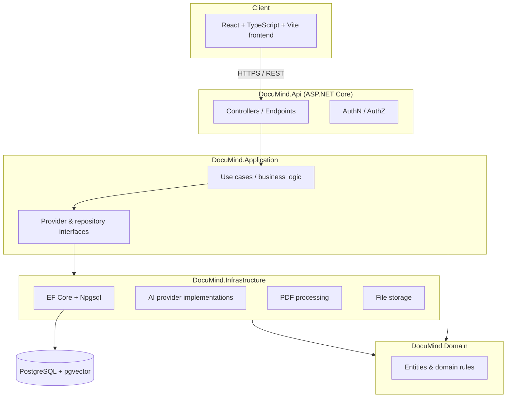

# DocuMind AI

Intelligent document search and AI knowledge assistant. Upload PDFs, search them with natural
language, and get grounded, citation-backed answers — never invented page numbers or quotes.

> **Status: Milestone 1 of 8 — Foundation.** This is an actively developed portfolio project.
> See [Project status](#project-status) for exactly what is implemented and verified today versus
> what is planned. Do not assume any feature exists beyond what's listed there.

## Problem statement

Students, researchers, and professionals routinely need to find specific facts buried in long
PDFs — handbooks, papers, policies, regulations — and then verify that what they found is actually
in the source document. Generic chatbots can answer confidently and still be wrong. DocuMind AI is
built around the opposite priority: every factual answer must be grounded in retrieved passages
from the user's own documents, with a real citation (document + page) the user can click to verify.
If the documents don't contain a reliable answer, the system says so instead of guessing.

## Main features (target scope)

- Multi-document PDF upload with page-level text extraction and processing status tracking.
- Semantic (vector) search over document chunks via PostgreSQL + pgvector, with optional keyword/hybrid search.
- Retrieval-augmented question answering with validated, clickable source citations.
- Document summarization (short, detailed, key points, section-by-section).
- Conversation history scoped to one user, one or more documents.
- Secure authentication, strict per-user document/conversation ownership on every request.
- Works in a development mode with a mock AI/embedding provider when no paid API key is configured.

## Architecture



Layer responsibilities follow a standard clean/layered architecture: **Domain** holds entities and
rules with no external dependencies; **Application** holds use cases and interfaces for everything
external (AI providers, storage, PDF extraction); **Infrastructure** implements those interfaces
against PostgreSQL, pgvector, and AI providers; **Api** exposes HTTP endpoints and wires everything
together via dependency injection.

## Technology stack

**Backend:** C#, ASP.NET Core Web API (.NET 10), Entity Framework Core 10, Npgsql, Serilog, Swashbuckle (OpenAPI/Swagger).
**Frontend:** React 19, TypeScript, Vite, Tailwind CSS v4, React Router, Axios.
**Database:** PostgreSQL 16 with the pgvector extension.
**Dev/Ops:** Docker Compose, GitHub Actions (planned), xUnit.

## Project status

### Implemented and verified (Milestone 1 — Foundation)

- Solution structure: `DocuMind.Domain`, `DocuMind.Application`, `DocuMind.Infrastructure`,
  `DocuMind.Api`, `DocuMind.Tests`, `DocuMind.IntegrationTests`, wired together with project
  references in [DocuMind.sln](DocuMind.sln).
- `AppDbContext` configured for PostgreSQL via Npgsql, with the `vector` extension registered
  ([src/DocuMind.Infrastructure/Persistence/AppDbContext.cs](src/DocuMind.Infrastructure/Persistence/AppDbContext.cs)).
  No entities yet — those arrive with the document library and RAG milestones.
- Health checks at `/health/live` (process liveness) and `/health/ready` (verifies a real
  PostgreSQL connection via `AspNetCore.HealthChecks.NpgSql`) — confirmed healthy against a live
  Dockerized Postgres instance.
- Swagger UI at `/swagger` via Swashbuckle, serving a real generated OpenAPI document — confirmed
  reachable with a running API.
- Serilog structured console logging, with request logging middleware.
- CORS configured for the local Vite dev origin (`http://localhost:5173`).
- React + TypeScript + Vite frontend with Tailwind CSS v4, React Router, and a reusable
  `Button` component. Landing page implemented per spec (hero, 3-step explainer, feature grid,
  illustrative example Q&A clearly labeled as illustrative, privacy messaging, footer) and a
  genuine 404 page for unmatched routes. Both verified by actually running the Vite dev server and
  screenshotting the rendered output — see [docs/screenshots/landing-page.png](docs/screenshots/landing-page.png).
- Docker Compose brings up PostgreSQL 16 with pgvector, backed by a named volume
  (`documind-postgres-data`) — confirmed the `vector` extension creates successfully.
- Git repository initialized; `.gitignore` covers .NET, Node, and IDE artifacts plus local upload
  storage; `.env.example` documents every configuration key without committing real secrets;
  local database connection string for `dotnet run` is stored via `dotnet user-secrets`, not in
  any committed file.

### Not yet implemented (planned, later milestones)

Authentication, document upload/processing, embeddings, semantic/keyword search, RAG chat,
summaries, conversation persistence, the dashboard/library/chat/settings pages, automated test
suites, and the full Docker Compose stack (API + frontend containers) all come in Milestones 2–8.
Nothing above this line should be assumed to exist.

## Prerequisites

- [.NET SDK 10](https://dotnet.microsoft.com/download) (developed against 10.0.301)
- [Node.js](https://nodejs.org/) 20+ (developed against 24.20.0 LTS) and npm
- [Docker Desktop](https://www.docker.com/products/docker-desktop/) (for PostgreSQL + pgvector)
- Git

## Getting started

### 1. Start PostgreSQL (with pgvector)

```powershell
docker compose up -d postgres
```

This starts PostgreSQL 16 with the pgvector extension available, on `localhost:5432`, using the
credentials in `docker-compose.yml` (override via a `.env` file copied from `.env.example`).

### 2. Configure the backend's database connection

The committed `appsettings.json` only contains a placeholder connection string. For local
development, set the real one via user secrets (never commit real credentials):

```powershell
cd src/DocuMind.Api
dotnet user-secrets set "ConnectionStrings:Postgres" "Host=localhost;Port=5432;Database=documind;Username=documind;Password=documind_dev_local_only"
```

### 3. Run the backend

```powershell
dotnet build
dotnet run --project src/DocuMind.Api
```

- Swagger UI: http://localhost:5180/swagger
- Liveness: http://localhost:5180/health/live
- Readiness (checks the database): http://localhost:5180/health/ready

### 4. Run the frontend

```powershell
cd frontend
npm install
npm run dev
```

Open http://localhost:5173. The Vite dev server proxies `/api/*` requests to the backend at
`http://localhost:5180`.

## Environment configuration

See [.env.example](.env.example) for every configuration key (database, AI provider, embedding
provider, upload limits, storage directory). Copy it to `.env` for Docker Compose, and use
`dotnet user-secrets` for the backend's local connection string rather than putting secrets in
`appsettings.json`.

## Running tests

```powershell
dotnet test
```

No test projects have meaningful tests yet — `DocuMind.Tests` and `DocuMind.IntegrationTests` are
scaffolded and will gain real coverage starting with Milestone 2 (authentication, document
upload/validation).

## Database and pgvector setup

Handled automatically by `docker compose up -d postgres` using the `pgvector/pgvector:pg16` image.
`AppDbContext.OnModelCreating` registers the `vector` PostgreSQL extension; EF Core migrations
(and the entities they create) are introduced starting with Milestone 3 once `Document` and
`DocumentChunk` exist.

## Security and privacy considerations

- No secrets are committed to the repository; `ConnectionStrings:Postgres` is stored via
  `dotnet user-secrets` locally and must come from environment variables in any deployed
  environment.
- CORS is restricted to an explicit allow-list of origins (configured in `appsettings.json`).
- Health check responses do not expose connection strings, stack traces, or other internal detail.
- Authentication, per-user ownership enforcement, upload validation, and prompt-injection
  mitigations for AI-generated answers are implemented in later milestones and documented in
  [docs/security.md](docs/security.md) as they land.

## Known limitations

This is Milestone 1 of 8. There is no authentication, no document upload, no AI integration, and
no persisted data model yet. The database contains no application tables. Treat this repository as
a verified foundation, not a usable product yet.

## Roadmap

See the milestone list in [docs/architecture.md](docs/architecture.md) for the full plan:
authentication & document library → PDF extraction/indexing → semantic search → RAG question
answering → summaries & source viewer → security hardening → deployment & portfolio readiness.

## Troubleshooting

- **`/health/ready` returns unhealthy / API fails to start with a connection error** — confirm
  `docker compose ps` shows `documind-postgres` as `healthy`, and that the user-secret connection
  string matches the credentials in `docker-compose.yml`.
- **Frontend can't reach the API** — confirm the backend is running on port 5180 and that
  `frontend/vite.config.ts`'s proxy target matches.
- **Docker commands fail with a pipe/engine error** — Docker Desktop isn't running; start it and
  wait for the engine to report ready (`docker info`) before retrying.

## License and attribution

License to be finalized before the project is made public. Third-party dependencies are listed in
[DocuMind.sln](DocuMind.sln)'s project files (`*.csproj`) and [frontend/package.json](frontend/package.json).
